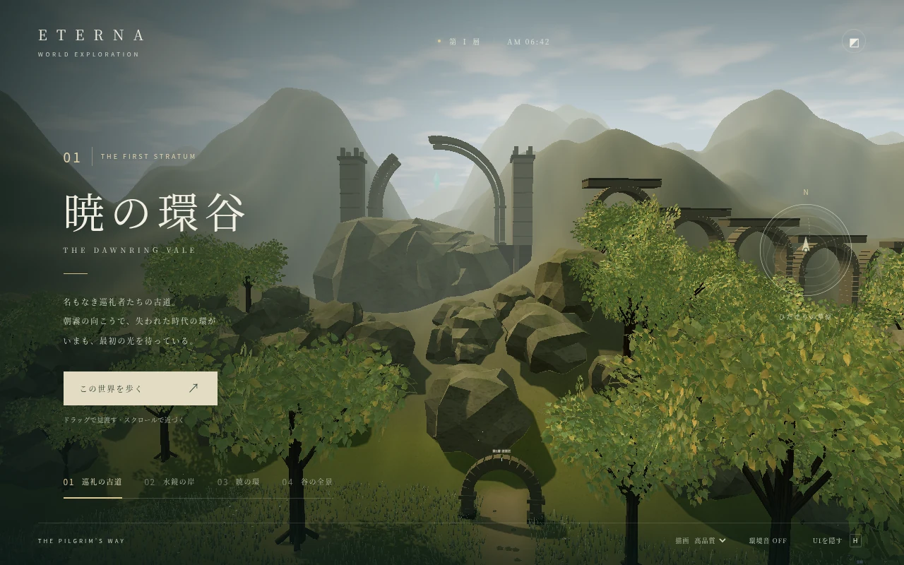

# 暁の環谷 / The Dawnring Vale

第1層 `f1_field`（ひだまりの草原）の新しい環境美術。ゲーム本体と専用プレビューで同じ地形・素材・配置を使う。



## 見る・歩く

```sh
npm ci
npm start
```

`http://localhost:8080/valley.html` を開く。

- ドラッグで視点、ホイールで距離を調整。下部の4つの場所で景観を切り替える。
- 「この世界を歩く」で三人称の探索。WASD / 矢印で移動、Shiftで走る。Escで景観表示に戻る。
- タッチ端末では画面右下の移動ボタンを使う。
- HでUIを隠す／戻す。環境音はボタンを押したときだけ再生する。
- 「軽量」は地形の分割数、樹冠、草花の数を減らし、影・ブルームを停止する。

ゲーム本体では、はじまりの街の北の出口から同じ草原へ入れる。既存の4つの出口、敵、宝箱、ワープポイントを維持。

## 美術の設計

朝霧の渓谷に残る、失われた文明の巡礼路。北の欠けた巨大な環を主役に、右奥の水道橋、左の水鏡と滝で方向を読めるようにする。中央の戦闘空間は開け、森と大きな起伏は外側へ寄せる。

地形・建築・草・樹木の骨格・岩・水・空・霧・素材はすべてこの変更で生成。環境アセットの外部CDNは使わない。白樺の枝葉だけは画像生成で作ったオリジナルの透過素材をWebP化して同梱。画像生成元は1254px RGBA、配布用は同サイズ・品質88のWebP。

石材、土、樹皮はCanvasで決定的に生成。樹冠と草には根元を固定した風の変形、草にはプレイヤー周囲の押し分けを適用。水はワールド座標の波紋・視線角による反射色で描画。環境音は風と遠い鳥をWeb Audioで合成する。

## 実装

| ファイル                                  | 役割                                                         |
| ----------------------------------------- | ------------------------------------------------------------ |
| `public/js/env/valley.js`                 | 地形メッシュ、建築、インスタンス植生、水、空、環境の組み立て |
| `public/js/env/valley-terrain.js`         | 地形の高さと道までの距離。道は緩く、外側に大きな起伏を配置   |
| `public/js/env/valley-materials.js`       | 決定的なテクスチャ生成、葉の画像、風・近景透過のシェーダー   |
| `public/js/valley-preview.js`             | 景観切り替え、三人称移動、品質設定、環境音                   |
| `public/assets/valley/birch-foliage.webp` | 画像生成した枝葉のアルファ素材                               |

`buildOpen` は `f1_field` を `buildValley` へ渡す。他のエリアは従来の描画。比較や開発用には `buildArea(def, floor, { legacy: true })` で従来版を組み立てられる。

大きな木・岩の位置はサーバーの `obstaclesOf` に従う。追加の森林・建築・大岩は移動境界の外へ配置。プレビューもゲームと同じ `collide` を使う。高さは描画のみで、ゲームの戦闘・同期は既存の平面モデルを使う。エリアを離れるときは生成テクスチャを解放し、ゲーム側の既存処理でメッシュとマテリアルを解放する。

## 検証

```sh
npm test
# Playwright がインストールされている環境:
node --test e2e/valley.e2e.mjs
# 必要なら PLAYWRIGHT_MODULE と CHROMIUM_PATH で実行環境を指定
```

新しい地形テストでは道の傾斜、戦闘空間の連続性、決定性を確認。ブラウザテストでは実際のシェーダーのコンパイル、品質設定によるジオメトリ削減と解放、歩行と障害物の衝突、景観の切り替え、スマートフォン幅の表示、ゲーム本体での入退場を確認する。

この変更は1エリアの美術と統合を対象とする。商用MMO全体の完成や、多人数・全端末での性能保証を示すものではない。実機GPUでの性能計測、距離によるLODやストリーミング、他エリアとキャラクターの美術統一は量産前に別途確認する。
