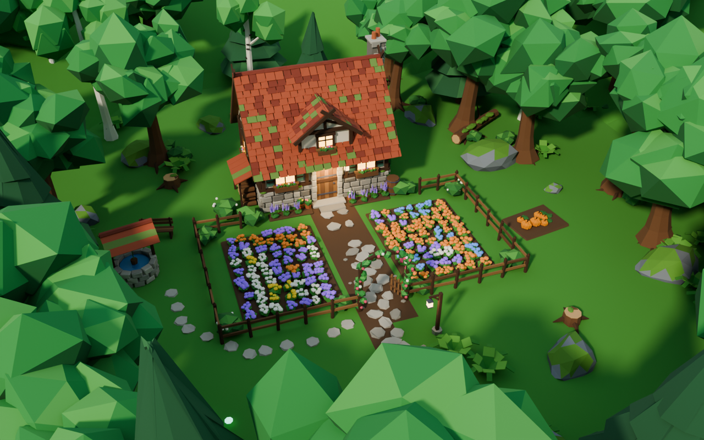
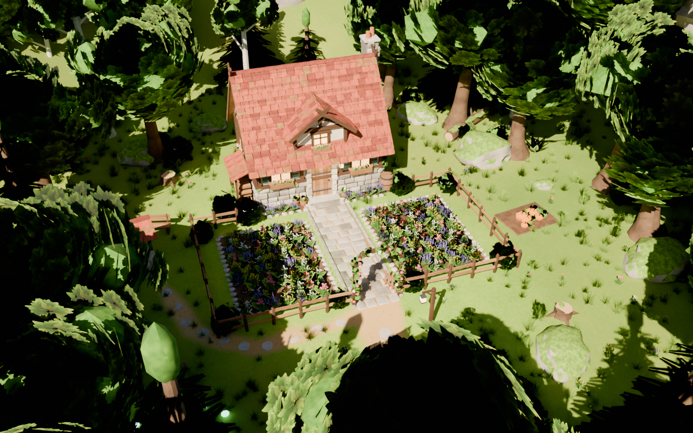
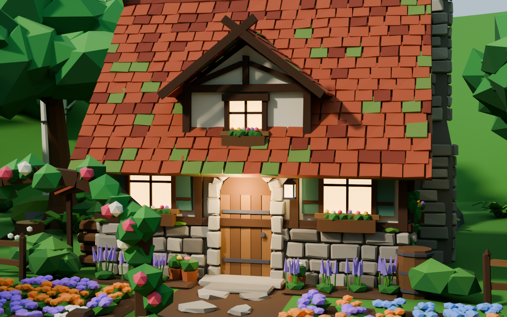
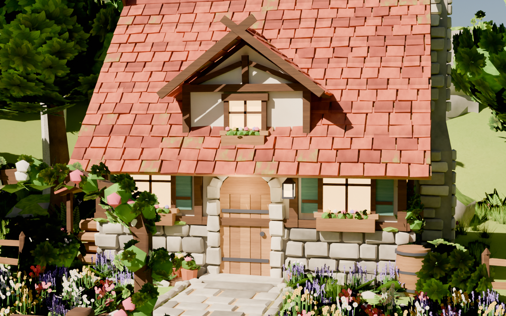
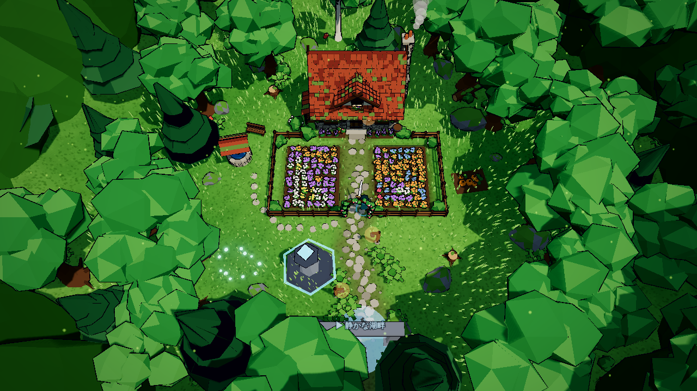
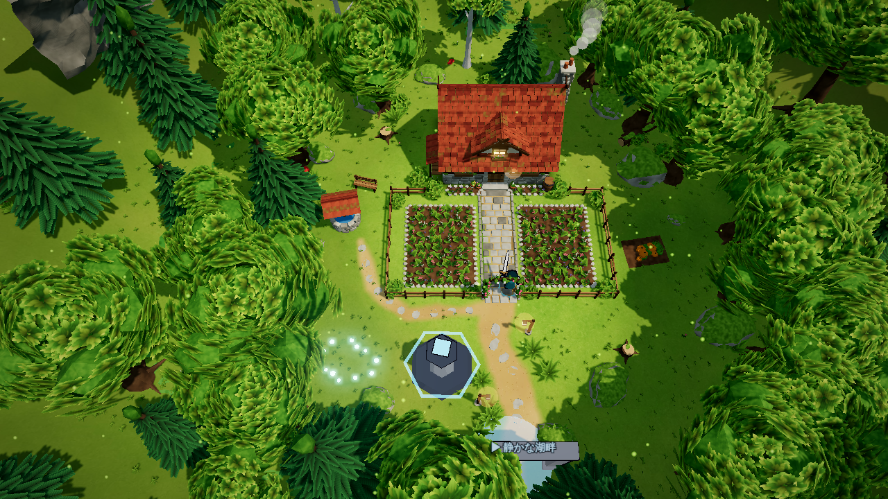
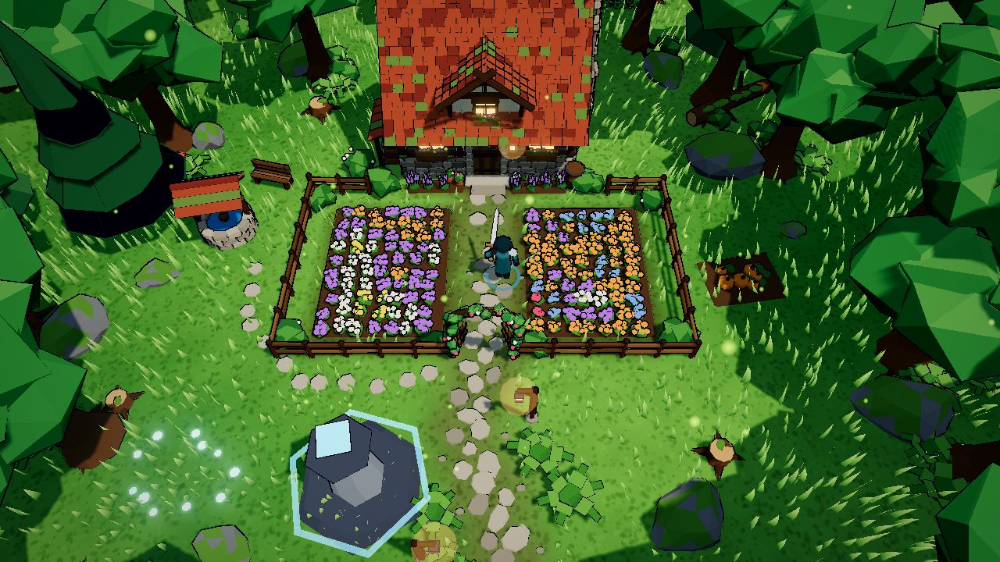
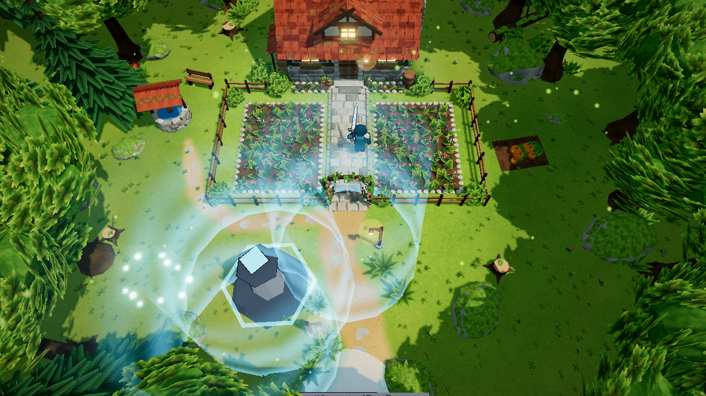
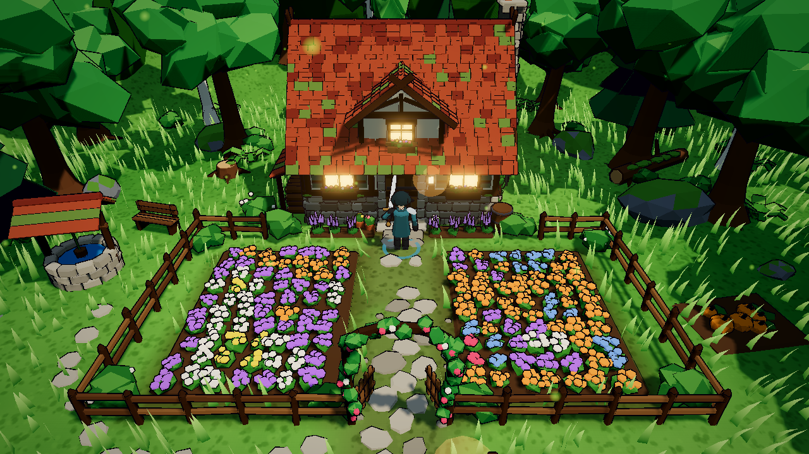
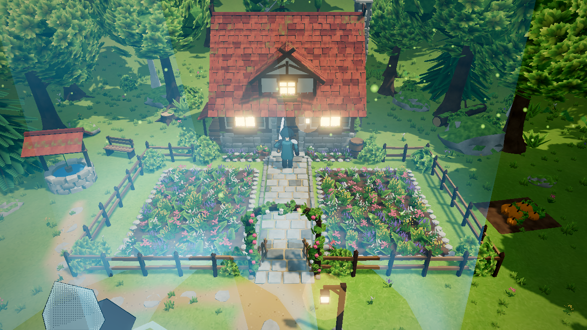

# 木漏れ日の小屋（f1_glade）: 現状版と RO3 風の比較版

第1層「静かな湖畔」の北東の出口から入る、森に囲まれた小さな一角（半径およそ 18 m）。
木と石の小屋・前庭・周りの森を Blender で作って並べ、ゲームに組み込んでいる。
敵は出ない。当たり判定と置き場所は両案で同じで、見た目だけが違う。

| | 現状版（基準。上書きしない） | RO3 風の比較版 |
|---|---|---|
| Blender スクリプト | `tools/blender/cottage_glade.py` | `tools/blender/cottage_glade_ro3.py` |
| 編集用 .blend | `tools/blender/cottage_glade.blend` | `tools/blender/cottage_glade_ro3.blend`（テクスチャは `tools/blender/ro3_textures/`） |
| GLB | `public/assets/models/blender/cottage_glade.glb` | `public/assets/models/blender/cottage_glade_ro3.glb` |
| レイアウト JS | `public/shared/glade-layout.js` | `public/shared/glade-layout-ro3.js`（当たり判定は現状版と同じ値） |
| ゲームで見る | `/?solo` で湖畔の北東の出口から | `/?solo&glade=ro3` |
| 絵づくり | トゥーン・フラットシェード・パレットの単色・輪郭線 | Blender で描いたテクスチャ・なめらかな面・葉と草の板・描いた地面・岩壁 |

## Blender のプレビュー（同じカメラ）

| 現状版 | RO3 風 |
|---|---|
|  |  |
|  |  |

## ゲームの画面（同じ位置・同じカメラ）

| 現状版 | RO3 風 |
|---|---|
|  |  |
|  |  |
|  |  |

## 作り直し方

```
blender -b -P tools/blender/cottage_glade.py -- --render        # 現状版（.blend・GLB・レイアウト・プレビュー）
blender -b -P tools/blender/cottage_glade_ro3.py -- --render    # RO3 風（現状版の .blend から配置を読む）
```

.blend で配置を手直ししたときは、現状版を `blender -b tools/blender/cottage_glade.blend -P tools/blender/cottage_glade.py -- --export-only` で
書き出し直し、そのあと RO3 風を作り直す（置き場所が同じになる）。
