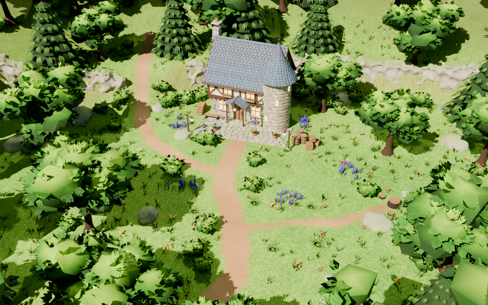
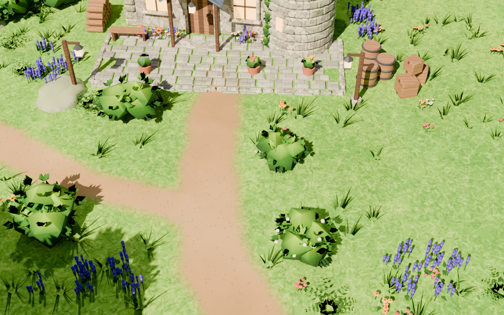
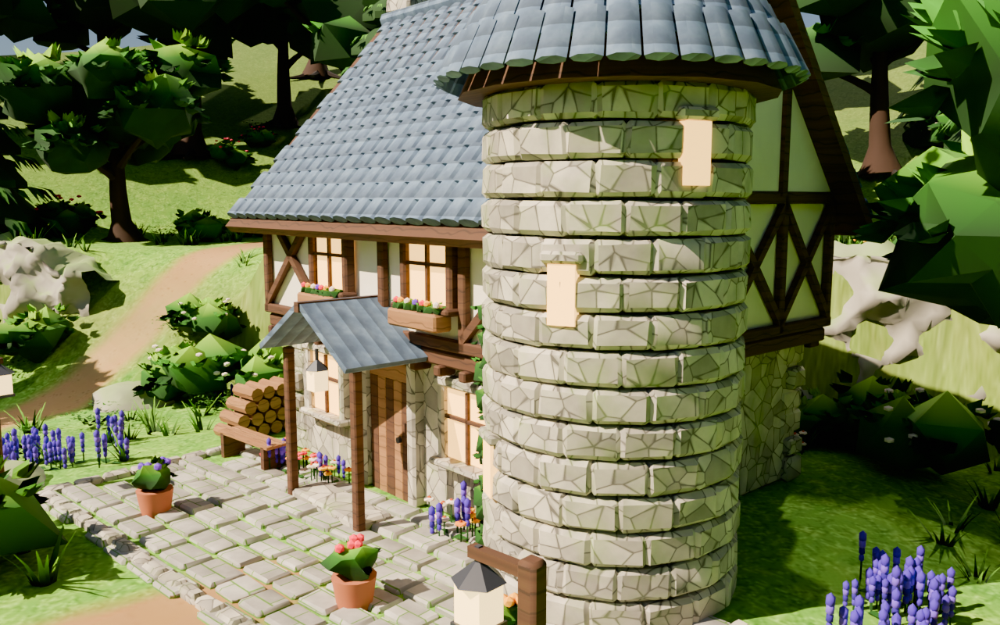
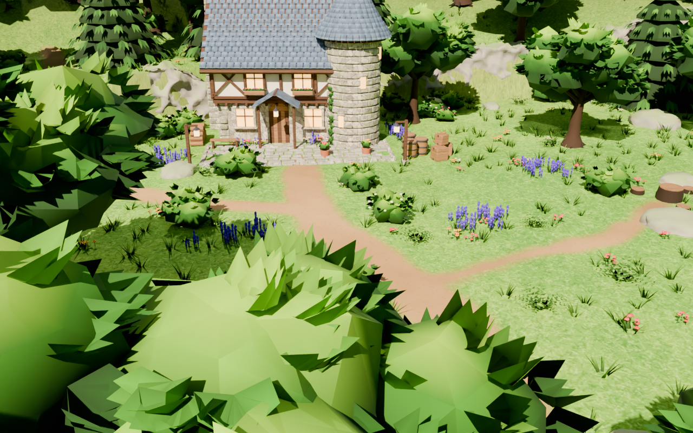
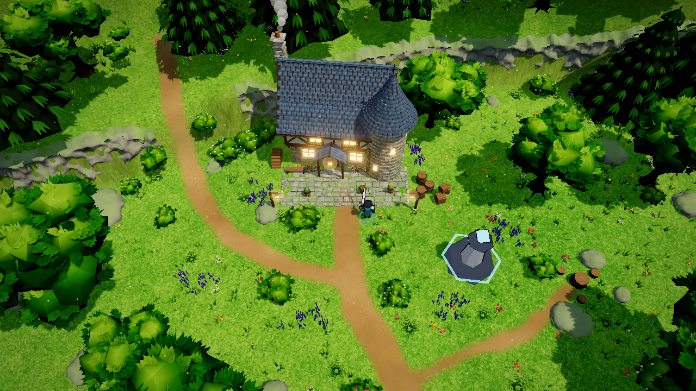
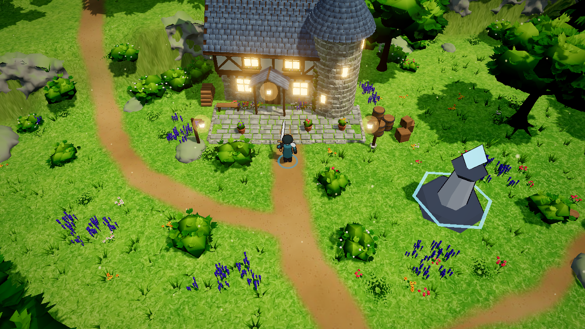
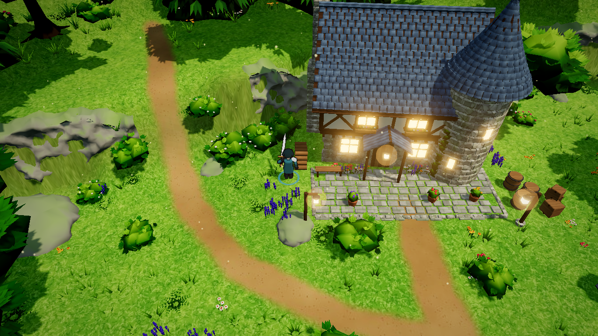
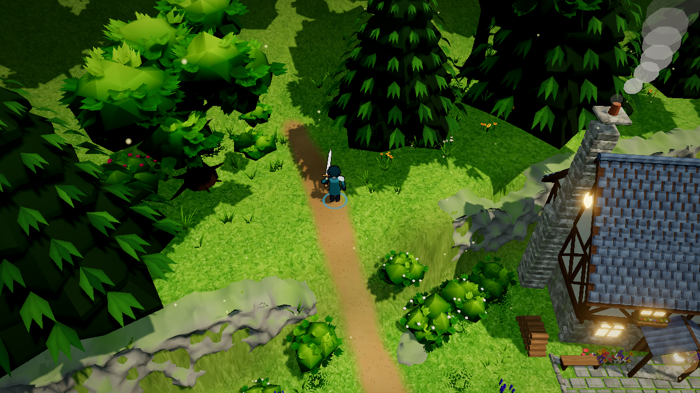

# 陽だまりの森の家（f1_hollow）— 見本（RO3 の明るい森）から作った新作

第1層「静かな湖畔」の北西の出口から入る、新しいエリア。
森に囲まれた明るい草地に、石と木の家、前庭の石畳、土の小道、岩の台地、周りの木と下草をまとめて置いた。
前回の「木漏れ日の小屋」（現状版・RO3 風の比較版）とは別のエリアで、前回のスクリプト・メッシュ・地形・配置は使っていない。
前回の 2 案は `docs/glade/` にそのまま残っている。敵は出ない。

| | |
|---|---|
| Blender スクリプト | `tools/blender/sunlit_hollow.py`（`blender -b -P tools/blender/sunlit_hollow.py -- --render`） |
| 編集用 .blend | `tools/blender/sunlit_hollow.blend`（テクスチャは `tools/blender/sunlit_hollow_textures/`） |
| ゲーム用アセット | `public/assets/models/blender/sunlit_hollow.glb` |
| レイアウト | `public/shared/hollow-layout.js`（当たり判定・地面の高さの表・明かり・煙突・ワープポイント） |
| ゲームで見る | `/?solo` → 静かな湖畔の北西の出口から、またはマップの転移で「陽だまりの森の家」 |

## Blender のプレビュー

| 全景 | ゲームに近い視点 |
|---|---|
|  |  |
| 小屋 | 入口からの小道 |
|  |  |

## ゲームの画面

| 全景（引き） | 前庭 |
|---|---|
|  |  |
| 台地の縁と岩壁 | 台地の上（西の坂を上ったところ） |
|  |  |

## 前回との違い

| | 前回（木漏れ日の小屋） | 新作（陽だまりの森の家） |
|---|---|---|
| 基準 | 既存のトゥーン調（RO3 風は同じ配置の上に素材を当て直した比較版） | 見本 4 枚の雰囲気が第一。トゥーン・輪郭線は使わない |
| 広さ・地形 | 半径 18 m、平ら | 横 30 m × 縦 24 m の楕円。北西に高さ 3.4 m の岩の台地、西に坂。地面の高さはゲームも同じ表で合わせる |
| 小屋 | 赤い板葺きの平屋に破風 | 石の 1 階と張り出した木組みの 2 階、青灰の丸瓦の急な屋根、角の円い塔（反った円錐屋根）、庇と吊り角灯、石の煙突 |
| 木 | 低ポリの塊（現状版）／葉を描いた板の重ね合わせ（RO3 風） | 立体の樹冠: でこぼこの葉の塊を枝先に重ね、表面に立体の葉の小枝を挿す。上は明るい黄緑、内側と下は深い緑（頂点の色）。針葉樹は垂れた枝の段を重ねる |
| 岩 | 丸い塊 | 台地の縁の岩壁と大岩。Blender のモディファイア（細分化・ディスプレイス〔ボロノイ・雲〕・ポリゴン削減）で作り、上向きの面に苔 |
| 地面 | 頂点の色（現状版）／1 枚の描いたテクスチャ（RO3 風） | 起伏のある地形と、描いたテクスチャ（明るい芝・土の道 3 本・台地の縁の土・森の床） |
| 前庭 | 柵と花壇 | 芝との境目がはっきりした石畳と縁石、角灯の柱、樽と木箱、薪の山、鉢植え、ベンチ（見本の天幕の代わり） |
| 下草 | 花の株・シダ | 道を縁取る低木とシダ、ラベンダーの群れ、芝に散る黄色い小花、草の株（立体の葉）850 か所 |
| 組み込み | 同じエリア f1_glade（RO3 風は `?glade=ro3` で入れ替え） | 別のエリア f1_hollow（湖畔に出口を 1 つ足した） |
